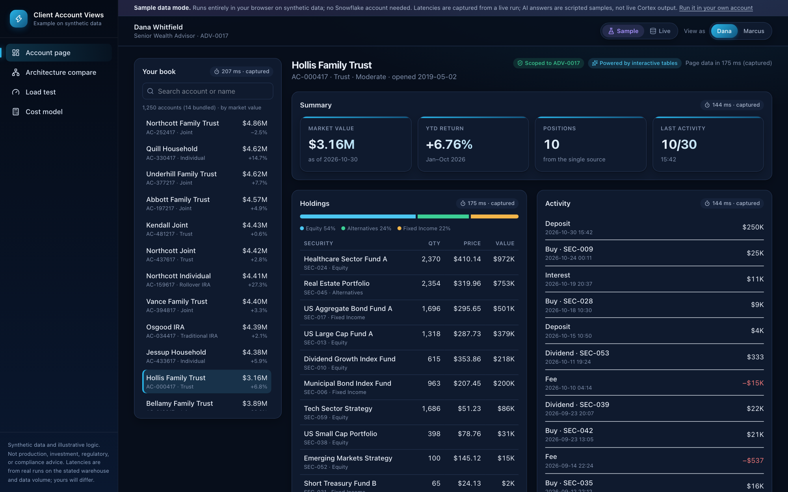

# Client Account Views at App Speed

Serve advisor- and client-facing account views (summary, holdings, activity, performance) straight
from Snowflake, instead of copying warehouse data into a separate reporting database just to power
fast screens. A Snowflake example for Wealth Management operations, on synthetic data.

- **Guide:** https://sfc-gh-ooral.github.io/sfguide-client-account-views/
- **Try it in your browser (no account):** https://sfc-gh-ooral.github.io/sfguide-client-account-views/try/



## What's in the app

| Screen | What it shows | Snowflake capability |
| --- | --- | --- |
| **Account page** | Book explorer, summary, holdings, activity, and a 24-month performance chart. Each widget shows its own query latency (live, or captured in Sample mode). "View as" switches between two advisors' books. **Call prep brief** drafts a summary for advisor review. | Interactive tables on an interactive warehouse; AI_COMPLETE |
| **Architecture compare** | Before (warehouse → nightly ETL → reporting database → reconciliation → API) vs after (Snowflake → API), freshness, and the reconciliation break the partial nightly load caused. Flag a break for operations with a note, or export CSV. | Dynamic Tables |
| **Load test** | N concurrent sessions (1–32) run the four account-page query shapes for random accounts. Shows p50/p95/p99, throughput, errors, a timeline, and estimated credits from your rate. Steady or peak-hour burst profile. | Interactive warehouse, pooled connections |
| **Cost model** | Before vs after monthly cost from inputs you enter. Nothing is prefilled and no savings are claimed. | — |

The app has a **Sample / Live** switch in the header. Sample mode uses `lib/mock/sample.json`: the same
synthetic rows, latencies, load-test runs, and AI text captured from a live run (see
`scripts/capture-sample.mjs`). Sample AI output is labeled **Sample AI response**. In Live mode, a failed
call shows the error; it never falls back to sample data.

## Prerequisites

- **No-account mode:** Node.js 20.19 or later.
- **Live mode:**
  - A Snowflake account in a region where [interactive warehouses](https://docs.snowflake.com/en/user-guide/interactive) are available (generally available in select AWS, Azure, and GCP regions). Tested in AWS US East (N. Virginia).
  - Tested on Enterprise Edition. ACCOUNTADMIN to run setup (it creates a least-privilege role and runs everything else as that role).
  - Cortex AI access for the call prep brief (`SNOWFLAKE.CORTEX_USER`; setup grants it). The default model is `claude-sonnet-4-5`; set `SNOWFLAKE_COMPLETE_MODEL` if it isn't available in your region.
  - Key-pair authentication (or a programmatic access token) for the user running the app.
- Tested with Next.js 16, snowflake-sdk 3.4, and Snowflake 10.41 in November 2026.

## Quick start (no account)

```bash
git clone https://github.com/sfc-gh-ooral/sfguide-client-account-views.git
cd sfguide-client-account-views
npm install
npm run dev    # http://localhost:3000
```

Leave `.env.local` absent and the app runs on the bundled sample data.

## Live mode: deploy to your account

1. Open a Snowsight worksheet as ACCOUNTADMIN, paste `sql/setup.sql`, and **Run All**. It finishes with a
   row count (500,000) and the four planted reconciliation breaks.
2. Create a key pair and register the public key on your user (commands in `.env.example`).
3. `cp .env.example .env.local` and set `SNOWFLAKE_ACCOUNT`, `SNOWFLAKE_USERNAME`, and
   `SNOWFLAKE_PRIVATE_KEY_PATH`. Keep the key outside the repository; `.env.local` is git-ignored.
4. `npm run dev`, open http://localhost:3000, and switch the header to **Live**.
5. When you're done, run `sql/cleanup.sql`. It drops everything and ends with three `SHOW` commands that
   should return no rows.

Optional: with Live mode running, `node scripts/capture-sample.mjs http://localhost:3000` refreshes the
Sample-mode bundle from your own run, and `npm run build:example` rebuilds the static example in `docs/try/`.

### Objects created

| Object | Type | Purpose |
| --- | --- | --- |
| `CAV_DEMO_ROLE` | Role | Owns every object below; granted to the user that ran setup. Account grants: CREATE DATABASE, CREATE WAREHOUSE, `SNOWFLAKE.CORTEX_USER` |
| `CAV_WH` | Warehouse, XSMALL, `AUTO_SUSPEND = 60` | Data generation, dynamic table refresh, interactive warehouse fallback, AI_COMPLETE |
| `CAV_IWH` | Interactive warehouse, XSMALL, `AUTO_SUSPEND = 3600` (the minimum) | Serves the account API; keeps the four interactive tables warm |
| `CLIENT_VIEWS_DEMO` | Database | Schemas `RAW`, `SERVING`, `REPORTING_COPY` |
| `RAW.ADVISORS`, `ACCOUNTS`, `SECURITIES`, `POSITIONS_EOD`, `ACTIVITY`, `PERFORMANCE_MONTHLY` | Tables | Synthetic analytics data: 400 advisors, 500K accounts, 20M positions, 50M activity rows, 12M monthly returns |
| `SERVING.HOLDINGS_CURRENT_DT`, `ACCOUNT_SUMMARY_DT` | Dynamic tables, 1-hour target lag | Serving shapes built from RAW |
| `SERVING.ACCOUNT_SUMMARY_IT`, `HOLDINGS_IT`, `ACTIVITY_IT`, `PERFORMANCE_IT` | Interactive tables with `TARGET_LAG = '1 hour'`, clustered by `(ADVISOR_ID, ACCOUNT_ID)` | What the account API queries |
| `REPORTING_COPY.POSITIONS_COPY`, `LOAD_LOG`, `RECON_BREAKS` | Tables and a view | The simulated duplicate path and its reconciliation |

### Expected cost and time

Measured in November 2026 on the account above:

- **Setup:** 2 minutes 48 seconds end to end; about **0.25 credits** on `CAV_WH` (XSMALL).
- **Interactive warehouse:** bills a minimum of **one hour** each time it resumes, then per second, and
  auto-suspends after one hour idle at the earliest. Budget at least one hour of an XSMALL interactive
  warehouse per session; check `WAREHOUSE_METERING_HISTORY` for actual use. Run `sql/cleanup.sql`
  (or `ALTER WAREHOUSE CAV_IWH SUSPEND`) when you're done.
- **Dynamic and interactive table refresh:** 1-hour target lag on `CAV_WH`; refreshes are small after the first.
- **AI_COMPLETE:** token charges per brief (one call of a few thousand input tokens).

### Measured latency

Round trip from a laptop app server to an XSMALL interactive warehouse (one cluster), result cache off,
500,000 accounts. These are the captured runs bundled in Sample mode; network distance dominates, so
measure from your own servers.

| Run | p50 | p95 | p99 | Throughput |
| --- | --- | --- | --- | --- |
| 4 sessions, steady, 20 s | 88 ms | 115 ms | 221 ms | 42.8 q/s |
| 16 sessions, steady, 20 s | 89 ms | 108 ms | 134 ms | 171.6 q/s |
| 32 sessions, steady, 20 s | 120 ms | 167 ms | 206 ms | 250.9 q/s |
| 16 sessions, peak-hour burst, 30 s | 80 ms | 96 ms | 156 ms | 95.7 q/s |
| 32 sessions, peak-hour burst, 30 s | 82 ms | 111 ms | 180 ms | 184.2 q/s |

A single account page runs its four widget queries in parallel; warm, each took about 110–200 ms round trip
in our tests. The first queries after the warehouse resumes are slower while its cache warms.

## Known limitations

- Latency numbers include the network to Snowflake and come from one client location; they aren't a benchmark.
- Interactive warehouses: one-hour minimum billing per resume, one-hour minimum auto-suspend, a fixed
  5-second statement timeout (longer queries retry on the fallback warehouse), and no CTAS or stored
  procedures on the interactive warehouse. Interactive tables don't support UPDATE or DELETE; they refresh from their sources.
- Advisor scoping is enforced in the API: every query binds `ADVISOR_ID`. For defense in depth in
  production, add a [row access policy](https://docs.snowflake.com/en/user-guide/security-row-intro) on the interactive tables keyed to the end user (Enterprise Edition).
- The load test runs inside the Next.js server process, so very high session counts measure the client
  too. Use a dedicated load generator for real capacity planning.
- The duplicate path is simulated with a table in the same database; it isn't a real external database.
- Flags on reconciliation breaks are saved in the browser only.

## Customize with Cortex Code

- "Profile my account summary API's queries and propose serving tables and clustering keys for interactive latency. Don't change any objects; show me the DDL first."
- "Generate a load test that replays my top 10 API query shapes with realistic parameters from my query history, and report p50, p95, and p99 by shape."
- "Compare the cost of this design against my current reporting database using my numbers, and list the assumptions."

## Repository layout

```text
app/                 Next.js pages (account page, architecture, load test, cost) and API routes
components/          Shell, Sample/Live switch, staged progress, shared UI
lib/                 Live queries (bound parameters, pooled connections), sample bundle, types
scripts/             Sample capture, hosted example build, screenshot capture
sql/                 setup.sql and cleanup.sql
data/README.md       Synthetic data and planted stories
docs/                GitHub Pages guide, screenshots, and the hosted example (docs/try/)
```

## License and disclaimer

Apache 2.0 (see `LICENSE`). This is an illustrative example provided as is, on synthetic data with
illustrative logic. It is not an official Snowflake product, it isn't supported by Snowflake Support, and
it isn't production, investment, regulatory, or compliance advice.

Owner: Oz Oral · Last reviewed: November 2026
