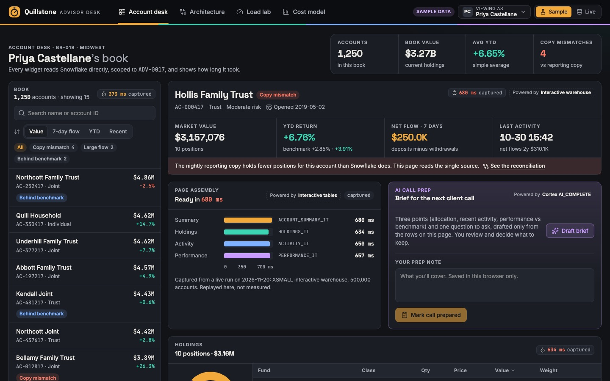

# Client Account Views at App Speed

Serve advisor- and client-facing account views (summary, holdings, activity, performance) straight
from Snowflake, instead of copying warehouse data into a separate reporting database just to power
fast screens. A Snowflake example for Wealth Management operations, on synthetic data, presented as
**Quillstone Advisor Desk**, a fictional advisor platform.

- **Guide:** https://sfc-gh-ooral.github.io/sfguide-client-account-views/
- **Try it in your browser (no account):** https://sfc-gh-ooral.github.io/sfguide-client-account-views/try/



## What's in the app

| Screen | What it shows | Snowflake capability |
| --- | --- | --- |
| **Account desk** | The advisor's book (search, sort, status pills for copy mismatches, large 7-day flows and accounts behind benchmark) and the account page: summary KPIs, a query waterfall showing how long each widget took, holdings with an allocation donut, a filterable activity feed, and growth of $100 vs benchmark. **AI call prep** drafts a cited brief; the advisor writes a note and marks the call prepared. "Viewing as" switches between two advisors' books. | Interactive tables on an interactive warehouse; Cortex `AI_COMPLETE` |
| **Architecture** | Before (warehouse → nightly ETL → reporting database → API) vs after (Snowflake → API), side by side on moving parts, freshness and position counts; the break table opens a position-by-position comparison. Export CSV or send the breaks to data ops. | Dynamic Tables, interactive tables |
| **Load lab** | 4–32 concurrent simulated sessions run the four account-page query shapes. Market-open replay (from the seeded peak-hour trace), burst or steady. Shows p50/p95/p99, max, throughput, errors, a per-second timeline and a latency histogram, plus a run log. | Interactive warehouse, pooled connections, bound parameters |
| **Cost model** | Before vs after monthly cost from inputs you enter, with a composition chart and a sensitivity curve by hours per day. Nothing is prefilled and no savings are claimed; an optional fill uses round placeholder numbers, labeled as such. | — |

The app has a **Sample / Live** switch in the header. Sample mode uses `lib/mock/sample.json`: the same
synthetic rows, latencies, load-test runs, and AI text captured from a live run (see
`scripts/capture-sample.mjs`). Sample AI output is labeled **Sample AI response** and keeps a realistic 5–7 second delay with staged steps; Live mode shows the same steps and the measured latency. In Live mode, a failed
call shows the error; it never falls back to sample data.

## Prerequisites

- **No-account mode:** Node.js 20.19 or later.
- **Live mode:**
  - A Snowflake account in a region where [interactive warehouses](https://docs.snowflake.com/en/user-guide/interactive) are available (generally available in select AWS, Azure, and GCP regions). Tested in AWS US East (N. Virginia).
  - Tested on Enterprise Edition. ACCOUNTADMIN to run setup (it creates a least-privilege role and runs everything else as that role).
  - Cortex AI access for the call prep brief (`SNOWFLAKE.CORTEX_USER`; setup grants it). The default model is `claude-sonnet-4-5`; set `SNOWFLAKE_COMPLETE_MODEL` if it isn't available in your region.
  - Key-pair authentication (or a programmatic access token) for the user running the app.
- Tested with Next.js 16, snowflake-sdk 3.4, and Snowflake 10.42 in November 2026, with key-pair authentication.

## Quick start (no account)

```bash
git clone https://github.com/sfc-gh-ooral/sfguide-client-account-views.git
cd sfguide-client-account-views
npm install
npm run dev    # http://localhost:3000
```

Leave `.env.local` absent and the app runs on the bundled sample data.

## Live mode: deploy to your account

1. Open a Snowsight worksheet as ACCOUNTADMIN, paste `sql/setup.sql`, and **Run All**. It finishes with a
   row count (500,000) and the four planted reconciliation breaks.
2. Create a key pair and register the public key on your user (commands in `.env.example`).
3. `cp .env.example .env.local` and set `SNOWFLAKE_ACCOUNT`, `SNOWFLAKE_USERNAME`, and
   `SNOWFLAKE_PRIVATE_KEY_PATH`. Keep the key outside the repository; `.env.local` is git-ignored.
4. `npm run dev`, open http://localhost:3000, and switch the header to **Live**.
5. When you're done, run `sql/cleanup.sql`. It drops everything and ends with three `SHOW` commands that
   should return no rows.

Optional: with Live mode running, `node scripts/capture-sample.mjs http://localhost:3000` refreshes the
Sample-mode bundle from your own run, and `npm run build:example` rebuilds the static example in `docs/try/`.

### Objects created

| Object | Type | Purpose |
| --- | --- | --- |
| `CAV_DEMO_ROLE` | Role | Owns every object below; granted to the user that ran setup. Account grants: CREATE DATABASE, CREATE WAREHOUSE, `SNOWFLAKE.CORTEX_USER` |
| `CAV_WH` | Warehouse, XSMALL, `AUTO_SUSPEND = 60` | Data generation, dynamic table refresh, interactive warehouse fallback, AI_COMPLETE |
| `CAV_IWH` | Interactive warehouse, XSMALL, `AUTO_SUSPEND = 3600` (the minimum) | Serves the account API; keeps the four interactive tables warm |
| `CLIENT_VIEWS_DEMO` | Database | Schemas `RAW`, `SERVING`, `REPORTING_COPY` |
| `RAW.ADVISORS`, `ACCOUNTS`, `SECURITIES`, `POSITIONS_EOD`, `ACTIVITY`, `PERFORMANCE_MONTHLY` | Tables | Synthetic analytics data: 400 advisors, 500K accounts, 20M positions, 50M activity rows, 12M monthly returns |
| `SERVING.HOLDINGS_CURRENT_DT`, `ACCOUNT_SUMMARY_DT` | Dynamic tables, 1-hour target lag | Serving shapes built from RAW |
| `SERVING.ACCOUNT_SUMMARY_IT`, `HOLDINGS_IT`, `ACTIVITY_IT`, `PERFORMANCE_IT` | Interactive tables with `TARGET_LAG = '1 hour'`, clustered by `(ADVISOR_ID, ACCOUNT_ID)` | What the account API queries |
| `REPORTING_COPY.POSITIONS_COPY`, `LOAD_LOG`, `RECON_BREAKS` | Tables and a view | The simulated duplicate path and its reconciliation |

No objects are created outside `CLIENT_VIEWS_DEMO`, the two warehouses and the role.

### Expected cost and time

Measured on 2026-11-20 in one AWS US East account:

- **Setup:** 2 minutes 53 seconds end to end; **0.30 credits** on `CAV_WH` (XSMALL), from `WAREHOUSE_METERING_HISTORY`.
- **Interactive warehouse:** bills a minimum of **one hour** each time it resumes, then per second, and
  auto-suspends after one hour idle at the earliest. Budget at least one hour of an XSMALL interactive
  warehouse per session at your rate in the Snowflake consumption table, and check
  `WAREHOUSE_METERING_HISTORY` for actual use. Run `sql/cleanup.sql` (or `ALTER WAREHOUSE CAV_IWH SUSPEND`) when you're done.
- **Dynamic and interactive table refresh:** 1-hour target lag on `CAV_WH`; refreshes are small after the first.
- **AI_COMPLETE:** token charges per brief (one call of a few thousand input tokens); a brief took 5–6 seconds.
- **Time to try it live:** about 15 minutes including setup, capture not required.

### Measured latency

Round trip from a laptop app server to an XSMALL interactive warehouse (one cluster), result cache off,
500,000 accounts, 5M current holdings, 50M activity rows. These are the captured runs bundled in Sample
mode. Network distance dominates, so measure from your own servers.

| Run | p50 | p95 | p99 | Throughput | Errors |
| --- | --- | --- | --- | --- | --- |
| 8 sessions, market-open replay, 30 s | 197 ms | 227 ms | 287 ms | 19.4 q/s | 0 |
| 16 sessions, market-open replay, 30 s | 196 ms | 210 ms | 272 ms | 39.7 q/s | 0 |
| 32 sessions, market-open replay, 30 s | 197 ms | 222 ms | 270 ms | 74.3 q/s | 0 |
| 16 sessions, burst, 30 s | 195 ms | 210 ms | 240 ms | 40.5 q/s | 0 |
| 32 sessions, burst, 30 s | 194 ms | 213 ms | 252 ms | 94.7 q/s | 0 |
| 8 sessions, steady, 20 s | 194 ms | 239 ms | 431 ms | 45.2 q/s | 0 |
| 32 sessions, steady, 20 s | 87 ms | 233 ms | 572 ms | 227.1 q/s | 0 |

An account page runs its four widget queries in parallel; across the 28 captured pages the median
widget round trip was about 210 ms and the median page-ready time (slowest widget) about 225 ms. The
first queries after the warehouse resumes, and right after setup, are slower while its cache warms.

## Known limitations

- Latency numbers include the network to Snowflake and come from one client location; they aren't a benchmark.
- Interactive warehouses: one-hour minimum billing per resume, one-hour minimum auto-suspend, a fixed
  5-second statement timeout (longer queries retry on the fallback warehouse), and no CTAS or stored
  procedures on the interactive warehouse. Interactive tables don't support UPDATE or DELETE; they refresh from their sources.
- Advisor scoping is enforced in the API: every query binds `ADVISOR_ID`. For defense in depth in
  production, add a [row access policy](https://docs.snowflake.com/en/user-guide/security-row-intro) on the interactive tables keyed to the end user (Enterprise Edition).
- The load test runs inside the Next.js server process, so very high session counts measure the client
  too. Use a dedicated load generator for real capacity planning.
- The duplicate path is simulated with a table in the same database; it isn't a real external database.
- Prep notes, "Mark call prepared" and "Send to data ops" are saved in the browser only; wire them to your own system of record.
- `AI_COMPLETE` model availability varies by region; set `SNOWFLAKE_COMPLETE_MODEL` if the default isn't available.

## Customize with Cortex Code

- "Profile my account summary API's queries and propose serving tables and clustering keys for interactive latency. Don't change any objects; show me the DDL first."
- "Generate a load test that replays my top 10 API query shapes with realistic parameters from my query history, and report p50, p95, and p99 by shape."
- "Compare the cost of this design against my current reporting database using my numbers, and list the assumptions."

## Repository layout

```text
app/                 Next.js pages (account desk, architecture, load lab, cost) and API routes
components/          Shell (top navigation), Sample/Live switch, account widgets, shared UI
lib/                 Live queries (bound parameters, pooled connections), sample bundle, types
scripts/             Seeded data generator, sample capture, hosted example build, screenshot capture
sql/                 setup.sql and cleanup.sql
data/                Seeded peak-hour trace and data/README.md (planted stories)
docs/                GitHub Pages guide, DESIGN.md, screenshots, and the hosted example (docs/try/)
```

## License and disclaimer

Apache 2.0 (see `LICENSE`). This is an illustrative example provided as is, on synthetic data with
illustrative logic. It is not an official Snowflake product, it isn't supported by Snowflake Support, and
it isn't production, investment, regulatory, or compliance advice.

Owner: Oz Oral · Last reviewed: November 2026
